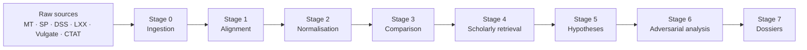

# Tessela

**A research assistant for Old Testament textual criticism.** Tessela brings the
Masoretic Text, Samaritan Pentateuch, Dead Sea Scrolls, Septuagint and Vulgate
into one source-aware dataset, surfaces translationally significant variants,
and (progressively) builds the evidence trail a translator needs: provenance,
uncertainty, scholarly discussion, competing hypotheses, and a reasoned
assessment.

[](https://github.com/normansimonr/tessela/actions/workflows/ci.yml)
[](LICENSE)
[](pyproject.toml)

> **Status:** active development. The data layer is substantial; the pipeline and
> dossier tooling are being built. The current cycle is repository readiness —
> see [`SPECS/ROADMAP.md`](SPECS/ROADMAP.md).

---

## Why this exists

A translator working through the Hebrew Bible must evaluate thousands of
textual variants spread across manuscripts, ancient translations, scholarly
editions, and secondary literature. Many differences are orthographic or
morphological and do not affect meaning; a much smaller set can change how a
passage is understood or translated.

Tessela is built to make that evaluation **efficient, transparent, and
reproducible**: it keeps every reading tied to its witness and source, marks
what is attested versus reconstructed, and preserves uncertainty instead of
flattening it into a verdict. It is a research assistant, not an autonomous
textual critic.

## A concrete example: Deuteronomy 32:8

The Masoretic Text reads “the sons of **Israel**”; 4Q37 (Deuteronomyᵇ) reads
“the sons of **God**”. Tessela stores both readings with their manuscript
sigla and the ETCBC transcription, and prints the comparison:

```text
$ make demo
DEU 32:8  (DEU)
========================================================================
MT   Leningrad Codex: בהנחל עליון גוים בהפרידו בני אדם יצב גבלת עמים למספר בני ישראל
DSS  4Q37: ב הנחיל עליון גוים ב הפרידו בני אדם יצב גבלת עמים ל מספר בני אלוהים
DSS  4Q45: ב הנחל עליון גוים ב הפרידו בני אדם יצב גבלת עמים

Differences vs MT (normalised consonantal comparison):
  DSS 4Q37: MT '' -> 'י'
  DSS 4Q37: MT 'ישר' -> ''
  DSS 4Q37: MT '' -> 'והים'
  DSS 4Q45: MT ' למספר בני ישראל' -> ''
```

The DSS readings are fetched by `make data-dss` (or `make data`); the
repository itself tracks only the reference lists. The comparison is
consonantal: vowel points, cantillation, maqaf and punctuation are normalised
away. DSS editorial markers (reconstruction,
uncertainty, damage, lacunae) are preserved in the `transcription` column of
`qumran.csv` and documented in
[`data/manual_datasets/qumran/README.md`](data/manual_datasets/qumran/README.md).

## What it does — and what is planned

**Works today**

- A curated, source-aware dataset of textual variants across MT, SP, DSS,
  Qere/Ketiv, the Tov Septuagint corpus, and CTAT/HOTTP references.
- On-demand Hebrew text for the curated Samaritan and DSS variant passages,
  with manuscript attribution and ETCBC editorial notation (fetched locally by
  `make data`, not tracked for licensing reasons).
- A consonantal comparison demo (`scripts/demo.py` / `make demo`).
- Reproducible generator scripts for the Qere/Ketiv, CTAT and Tov datasets
  (`scripts/qere-ketiv`, `scripts/ctat-refs`, `scripts/lxx-refs`), with tests.

**In progress / planned** (see the roadmap)

- A stage-gated SQLite pipeline (ingestion → alignment → normalisation →
  comparison → scholarly retrieval → hypotheses → adversarial analysis →
  dossiers).
- A `tessela` CLI and Markdown/PDF research dossiers.
- Structured semantic evaluation with three levels of significance (formal,
  semantic, interpretive).
- Textual-development hypotheses as directed graphs with evidence and
  probabilities.
- The Monica / Tomás / Ernesto adversarial analysis workflow.

## Architecture

Tessela is designed as a linear, stage-gated pipeline. Each stage consumes the
previous stage's SQLite database and writes a new one, so any stage can be
re-run in isolation.



The design is documented in [`SPECS/TECH.md`](SPECS/TECH.md); the full research
vision is in [`SPECS/MISSION.md`](SPECS/MISSION.md).

## Quickstart

```bash
python3 -m venv .venv && source .venv/bin/activate
pip install -r requirements.txt
make data-samaritan       # fetch the non-commercial Samaritan Hebrew text
make demo                 # print the MT / SP / DSS comparison for DEU 32:8
```

The repository tracks the **reference lists** for the Samaritan and DSS
variants. Their readings are non-commercial, so they are fetched locally into
`data/derived/` (git-ignored):

```bash
make data-samaritan    # STEPBible SP module (~1 MB)
make data-dss          # ETCBC/dss clone (~2.5 GB, optional)
make data-septuagint   # rebuild from local Tov CATSS .par files
make data              # all of the above
```

Try other curated references (after `make data-samaritan`):

```bash
python3 scripts/demo.py "Genesis 2:2"       # SP reads "the sixth" for MT "the seventh"
python3 scripts/demo.py "Deuteronomy 27:4"  # SP reads Mount Gerizim for MT Mount Ebal
```

Render a full Markdown dossier:

```bash
./scripts/tessela dossier "DEU 32:8"
./scripts/tessela dossier "GEN 2:2" --format text
./scripts/tessela dossier "DEU 27:4" --out /tmp/deu-27-4.md
make examples      # render DEU 32:8, GEN 2:2 and DEU 27:4 into data/derived/examples/
```

## Development

```bash
make install-dev   # runtime + ruff, mypy, pytest
make lint          # ruff + mypy
make test          # pytest
make check         # lint + test
```

CI runs the same checks on every push and pull request (`.github/workflows/ci.yml`).

The project is developed **spec-first**: `SPECS/MISSION.md` is the product
contract, `SPECS/TECH.md` the technical contract, and `SPECS/ROADMAP.md` the
delivery plan. Features are specified before they are implemented, and the
current cycle is tracked in the roadmap.

## Repository layout

```
tessela/
├── data/                  # Curated datasets, raw sources, SQLite, reference tables
│   ├── manual_datasets/   # Qere/Ketiv, Samaritan, DSS, CTAT
│   ├── intermediate_datasets/  # Septuagint corpus and normalisations
│   ├── reference/         # Book catalog, Leningrad versification
│   ├── raw/               # ebible sources, Tov CATSS files (git-ignored)
│   └── sqlite/            # bible.db and alignment views
├── scripts/               # Pipeline and generator scripts (+ tests)
├── src/                   # Application modules (data loading, witnesses, AI service)
├── prompts/               # AI prompt templates
├── SPECS/                 # Mission, tech spec, roadmap, feature specs
├── .github/workflows/     # CI
├── Makefile
├── pyproject.toml         # ruff, mypy, pytest configuration
└── requirements*.txt
```

See [`data/README.md`](data/README.md) for the dataset inventory, provenance and
the mapping from the original import layout.

## Data and licensing

The **code is MIT** (see [`LICENSE`](LICENSE)). The **data has separate
licences**; the full details are in [`DATA_LICENSES.md`](DATA_LICENSES.md).

The non-commercial datasets are **not tracked**. The repository contains only
the factual reference lists for the Samaritan and DSS variants; their readings
are fetched locally into `data/derived/` (git-ignored) by `make data`. The
most important terms:

- **Samaritan Pentateuch text:** STEPBible SP / CrossWire, “Copyrighted; Free
  non-commercial distribution”, digitized by Aleksandr Sigalov.
- **Dead Sea Scrolls readings:** ETCBC/dss, **CC BY-NC 4.0**, based on Martin
  Abegg’s data.
- **Qere/Ketiv:** STEPBible TAHOT, CC BY 4.0.
- **Septuagint:** Tov CATSS `.par` files are **not tracked**; the derived corpus
  is rebuilt into `data/derived/` from local `.par` files, and the English texts
  are public domain.
- **CTAT/HOTTP:** page references only; the copyrighted CTAT PDFs are not
  tracked.

If you plan to reuse the data, check `DATA_LICENSES.md` first. If you are a
commercial user, the non-commercial datasets need separate permission from their
providers.

## Contributing

Issues and pull requests are welcome. The current priorities are in
[`SPECS/ROADMAP.md`](SPECS/ROADMAP.md). For anything non-trivial, open an issue
first so the scope can be agreed.

## Citation

If you use Tessela in research, please cite the repository and the underlying
datasets listed in `DATA_LICENSES.md`. A `CITATION.cff` is planned.
